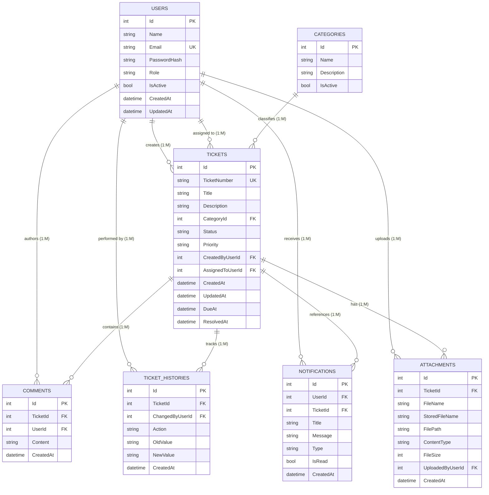

# Database Design & Schema Documentation

The system uses **SQLite** through **Entity Framework Core 11 Code-First** migrations.

---

## 1. Entity-Relationship Diagram (ERD)

---

## 2. Table Specifications & Constraints

### `Users` Table
- `Id`: INTEGER, Primary Key, Autoincrement.
- `Email`: TEXT, Unique Index (`IX_Users_Email`), Case-Insensitive comparison.
- `PasswordHash`: TEXT, Stores salted BCrypt cryptographic hash.
- `Role`: TEXT, Value restricted to `Employee`, `Agent`, or `Admin`.
- `IsActive`: INTEGER (Boolean), Defaults to `1`. Used for soft account deactivation.

### `Categories` Table
- `Id`: INTEGER, Primary Key, Autoincrement.
- `Name`: TEXT, Not Null (e.g. "Hardware", "Software", "Network").
- `Description`: TEXT.
- `IsActive`: INTEGER (Boolean), Defaults to `1`.

### `Tickets` Table
- `Id`: INTEGER, Primary Key, Autoincrement.
- `TicketNumber`: TEXT, Unique Index (`IX_Tickets_TicketNumber`). Sequential format: `TCK-yyyyMM-XXXX`.
- `CategoryId`: INTEGER, Foreign Key to `Categories.Id` with `ON DELETE RESTRICT` (protects tickets if category is referenced).
- `CreatedByUserId`: INTEGER, Foreign Key to `Users.Id` with `ON DELETE RESTRICT` (protects ticket records if employee leaves).
- `AssignedToUserId`: INTEGER, Nullable Foreign Key to `Users.Id` with `ON DELETE SET NULL` (unassigns ticket if technician account is deleted).
- `Status`: TEXT, Values: `Open`, `InProgress`, `OnHold`, `Resolved`, `Closed`.
- `Priority`: TEXT, Values: `Low`, `Medium`, `High`, `Critical`.
- `DueAt`: TEXT (UTC DateTime), Calculated SLA deadline.
- `ResolvedAt`: TEXT (UTC DateTime), Timestamp when marked Resolved.

### `Comments` Table
- `Id`: INTEGER, Primary Key, Autoincrement.
- `TicketId`: INTEGER, Foreign Key with `ON DELETE CASCADE` (deleting ticket purges thread).
- `UserId`: INTEGER, Foreign Key with `ON DELETE RESTRICT`.
- `Content`: TEXT, Up to 4000 characters.

### `TicketHistories` Table
- `Id`: INTEGER, Primary Key, Autoincrement.
- `TicketId`: INTEGER, Foreign Key with `ON DELETE CASCADE`.
- `ChangedByUserId`: INTEGER, Foreign Key with `ON DELETE RESTRICT`.
- `Action`: TEXT (e.g. `TicketCreated`, `Assigned`, `StatusChanged`, `PriorityChanged`, `CommentAdded`, `AttachmentAdded`).
- `OldValue` & `NewValue`: TEXT, Captures delta changes.

### `Notifications` Table
- `Id`: INTEGER, Primary Key, Autoincrement.
- `UserId`: INTEGER, Foreign Key with `ON DELETE CASCADE`.
- `TicketId`: INTEGER, Nullable Foreign Key with `ON DELETE SET NULL`.
- `IsRead`: INTEGER (Boolean), Defaults to `0`.

### `Attachments` Table
- `Id`: INTEGER, Primary Key, Autoincrement.
- `TicketId`: INTEGER, Foreign Key with `ON DELETE CASCADE`.
- `FileName`: TEXT, Original file name.
- `StoredFileName`: TEXT, Randomized GUID file name.
- `FileSize`: INTEGER, Size in bytes.
- `UploadedByUserId`: INTEGER, Foreign Key with `ON DELETE RESTRICT`.

